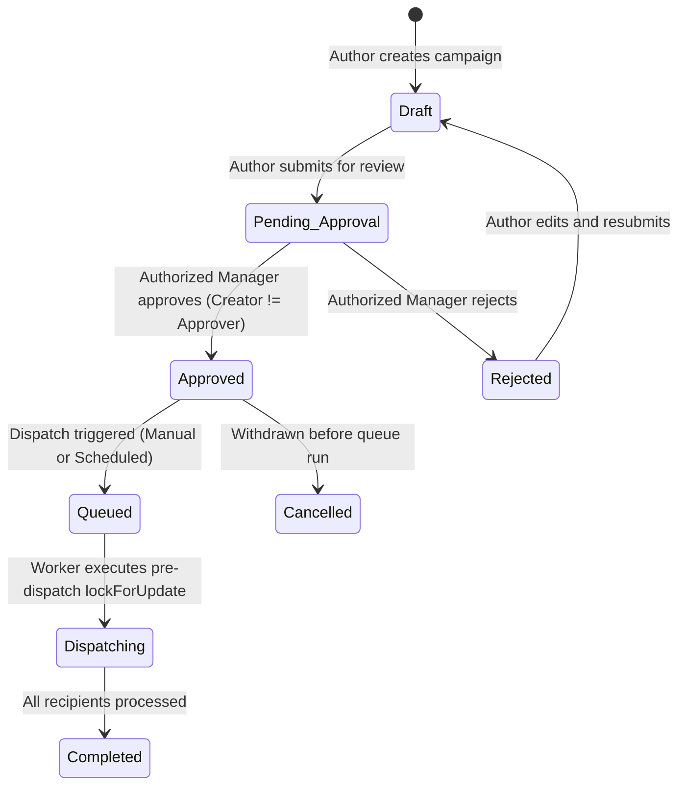

# InoManage Cloud Multi-Tenant SaaS ERP
# CRM Multi-Channel Telecommunications Architecture

**Document Version:** 2.1.0  
**Phase:** Stage 2 CRM, Gate 0: Architecture & Design Revision 2.1 (Final Security Reconciliation)  
**Classification:** Telecommunications & Integrations Architecture  
**Path:** `docs/crm/CRM_COMMUNICATION_ARCHITECTURE.md`

---

## 1. Meta WhatsApp Cloud API Architecture

In accordance with approved business requirements, InoManage Cloud ERP avoids centralized phone number sharing. **Each tenant connects its own WhatsApp Business Account (WABA)** via the official Meta Graph API (configurable `config('services.meta.graph_version', 'v21.0')`, minimum supported v19.0).

```
+-------------------------------------------------------------------------------------------------+
|                               Meta Cloud Infrastructure (WhatsApp)                              |
+-------------------------------------------------------------------------------------------------+
           |                                                                 ^
  Incoming Webhook POST                                             Outbound Graph API (v21.0)
  (Signed with Platform App Secret)                                 (POST /{graph_ver}/{phone_id}/messages)
           |                                                                 |
           v                                                                 |
+----------------------------------------------------------------------------+--------------------+
| InoManage Central Webhook Ingress                                          | Tenant Worker      |
|                                                                            |                    |
| 1. Validate X-Hub-Signature-256 against Platform Meta App Secret           | 1. Restore Tenant  |
| 2. Store raw event in crm_webhook_events (Deduplication Check)             | 2. Decrypt Token   |
| 3. Parse destination phone_number_id & waba_id                             | 3. Rate-limit (80/s)
| 4. Resolve Tenant (team_id) via crm_channels table                         | 4. Post to Meta    |
| 5. If unmatched: log warning, return HTTP 200, terminate                   | 5. Update Status   |
| 6. Dispatch ProcessInboundWebhookJob to Redis queue                        |                    |
+----------------------------------------------------------------------------+--------------------+
```

### 1.1 Meta App Ownership vs Tenant WABA Ownership
* **Platform Meta App:** The InoManage platform operates a single verified Meta Developer App. This App holds the Webhook subscription product and configuration.
* **Tenant WABA:** Each tenant owns their legal WhatsApp Business Account, business profile, phone number, and billing relationship with Meta.
* **Onboarding via Embedded Signup:** Tenants connect their WABA using Meta's official **Embedded Signup Flow** (Facebook Login for Business). During onboarding, the tenant authorizes the InoManage Platform App to manage their WABA. Meta returns an authorization code, which the InoManage backend exchanges for a System User Permanent Access Token and stores encrypted in `crm_channels.credentials`.

### 1.2 Webhook Signature Verification & Unknown Channel Handling
* **Platform Signature Verification:** Because Meta delivers webhook notifications configured under the Platform App, Meta signs the payload using the **Platform Meta App Secret** (`config('services.meta.app_secret')`), NOT the tenant access token. The ingress controller verifies `X-Hub-Signature-256` using constant-time hash comparison against the platform secret.
* **Unknown Channel Handling:** If an incoming webhook contains a `phone_number_id` or `waba_id` that cannot be resolved in `crm_channels`:
  * The event is recorded in `crm_webhook_events` with status `'unmatched_channel'`.
  * A warning is logged to `laravel.log`.
  * An HTTP 200 response is returned to Meta to acknowledge receipt without triggering Meta delivery retries, and no background jobs are dispatched.
* **Durable Event Storage & Normalized Event Scope Key:** The raw payload and SHA-256 hash are recorded in `crm_webhook_events`. Event deduplication and replay defense enforce a unique constraint on `(provider, event_scope_key, external_event_id)`:
  - Global event identifiers use a stable global scope identifier (`event_scope_key = 'global'`).
  - Account-scoped identifiers use a stable provider-account identifier (e.g. `event_scope_key = provider_account_id`).
  - **Payload Identity Semantics:** The system validates payload structure rather than assuming Meta WhatsApp WAMID is a top-level webhook event ID. Meta payloads deliver batches of changes under `entry[].changes[].value` containing messages (`messages[].id`) or status receipts (`statuses[].id`). Event ingestion extracts atomic event items, validates their identity semantics, and stages them with their corresponding scope key.
  - **Duplicate & Concurrency Defense:** If a duplicate event arrives or concurrent deliveries occur, the database unique key prevents duplicate inserts; the handler acknowledges with HTTP 200 (status `'duplicate'`) and terminates without dispatching duplicate background jobs.

---

## 2. BulkSMSBD SMS Gateway Integration

BulkSMSBD (`bulksmsbd.com`) is the initial telecommunications SMS aggregator for the Bangladesh market.

### 2.1 Architectural Comparison & Operational Models

| Dimension | Option A: Tenant-Specific Credentials (Approved Launch Default) | Option B: Platform-Managed SMS Gateway (Future Add-On) |
| :--- | :--- | :--- |
| **Account Ownership** | Each tenant maintains their own BulkSMSBD account. | InoManage platform maintains a master BulkSMSBD enterprise account. |
| **Billing & Payments** | Tenant-owned BulkSMSBD credentials establish separate provider account ownership and billing responsibility. The SaaS platform remains responsible for its own applicable security, privacy, contractual and regulatory obligations according to its role and applicable law. | Platform sells SMS credit packs to tenants with a margin. Platform absorbs payment fees and unpaid usage. |
| **Sender ID Registration**| Tenant registers their own alphanumeric/masking Sender ID with BTRC through BulkSMSBD. | All tenants either share a generic platform Sender ID or the platform manages sub-masking approval. |
| **Tenant Accounting** | Real-time balance checked via BulkSMSBD API (`GET /api/v2/balance`). | Platform maintains internal SMS credit ledger and locks sending when balance reaches zero. |
| **Platform Liability** | Tenant-owned BulkSMSBD credentials establish separate provider account ownership and billing responsibility. The SaaS platform remains responsible for its own applicable security, privacy, contractual and regulatory obligations according to its role and applicable law. | InoManage platform holds master account liability if a tenant sends fraudulent or spam SMS. |

### 2.2 BulkSMSBD Inbound Limitations & Opt-Out Workflows
* **Aggregator Reality:** Standard BulkSMSBD accounts operate primarily as outbound HTTP API gateways. Two-way inbound SMS (direct keyword reply) requires an operator-level dedicated shortcode or virtual number integration.
* **Alternative Compliance Workflows:** For standard outbound SMS marketing, the CRM provides alternative regulatory opt-out paths:
  1. **Mandatory Web Unsubscribe Merge Tag:** Outbound SMS campaigns automatically append a signed, short web unsubscribe link: `e.g. opt.ino.app/{token}`.
  2. **WhatsApp Cross-Channel Opt-Out:** Inbound WhatsApp messages replying `STOP` or `বন্ধ` automatically update `crm_consents` to suppress future SMS and WhatsApp marketing.
  3. **Manual Agent Opt-Out:** Staff can immediately toggle customer consent status in the Customer 360 cockpit.

---

## 3. Tenant-Configured SMTP & Isolated Worker Lifecycle

To protect tenant domain deliverability and SPF/DKIM/DMARC reputation, tenants configure their own corporate email transport.

### 3.1 Dedicated Per-Tenant Symfony Mailer Transport with Explicit Shutdown and Cleanup
To prevent cross-tenant state leakage in persistent queue workers (`queue:work`), global configuration mutation (`config(['mail.mailers.smtp => ...'])`) is strictly prohibited.
Instead, `TenantMailService` instantiates a dedicated per-tenant Symfony Mailer transport (`Symfony\Component\Mailer\Transport\Smtp\EsmtpTransport`) dynamically, ensuring explicit shutdown and cleanup across all execution paths:
```php
public function sendTenantMail(int $teamId, Mailable $mailable, string $recipient): void
{
    $channel = CrmChannel::where('team_id', $teamId)
        ->where('channel_type', 'email')
        ->where('is_active', true)
        ->firstOrFail();

    $transport = new EsmtpTransport(
        $channel->credentials['smtp_host'],
        (int) $channel->credentials['smtp_port'],
        $channel->credentials['smtp_encryption'] === 'tls'
    );
    $transport->setUsername($channel->credentials['smtp_username']);
    $transport->setPassword($channel->credentials['smtp_password']);

    $mailer = new \Symfony\Component\Mailer\Mailer($transport);
    try {
        $mailer->send($mailable->toSymfonyEmail($recipient));
    } finally {
        $transport->stop(); // Explicitly disconnect and terminate socket
        unset($transport, $mailer);
    }
}
```

---

## 4. Mandatory Campaign Approval & Dual-Custody Governance



### 4.1 Strict Dual-Custody Invariants
1. **Unconditional Creator Separation:** The user who authored the campaign (`created_by`) **cannot** approve it under any circumstances (`created_by !== approver_id` is unconditional).
2. **Absolute Owner Equality:** Tenant Owners are subject to exactly the same rule. There is no Owner self-approval exception, and no configuration flag may enable Owner self-approval. If an Owner creates a campaign, another authorized staff member (Admin or Sales Manager) must approve it. If a single-user tenant workspace exists without a second user, campaign broadcasts are locked until a second authorized user is added.
3. **Approval Invalidation on Modification:** Any material change to campaign content, target segment, channel, or schedule invalidates prior approval and immediately resets campaign status back to `draft`.
4. **Pre-Dispatch Atomic Validation:** Inside `ProcessCampaignBatchJob`, a database transaction with `lockForUpdate()` executes final server-side checks verifying:
   * Status is `approved` and `approved_by` is not null.
   * Approver is different from creator (`approved_by !== created_by`).
   * Channel is active with valid credentials.
   * Recipient is not in `crm_consents` as `opted_out` or `dnd_national`.
   * Template parameters match approved Meta/BTRC templates.

---

## 5. Regulatory Consent, DND Registry & Suppression

Compliance with Bangladesh Telecommunication Regulatory Commission (BTRC) and international anti-spam standards is enforced by design.

* **Tenant Opt-Outs vs National DND:**
  * `opted_out`: Customer explicitly withdrew consent from this specific tenant.
  * `dnd_national`: Number is registered on official telecommunications Do Not Disturb registries.
* **Authoritative Source & Sync Reality:**
  * The BTRC does not currently expose a publicly accessible, real-time programmatic REST API for third-party SaaS vendors. Carrier-level DND filtering is performed by mobile network operators.
  * For local compliance, tenants can import official DND CSV/tabular lists or carrier rejection logs into `crm_consents` with status `'dnd_national'`.
* **Opt-In Evidence Tracking (`crm_consents`):** Captures `destination`, `channel_type`, `status`, `purpose`, `source` (`web_form`, `pos_receipt`, `keyword_stop`, `btrc_dnd`), and `opt_in_evidence` (timestamp, IP address, agreement text).
* **Automated Keyword Trapping:** Inbound messages containing `STOP`, `UNSUBSCRIBE`, `CANCEL`, or Bengali equivalents (`বন্ধ`, `বাতিল`) are intercepted by `ProcessInboundWebhookJob`. The sender is immediately marked `opted_out` in `crm_consents`, and an auto-confirmation is returned.
* **Pre-Dispatch Suppression Join:** Every campaign dispatch query excludes any recipient present in `crm_consents` where `status IN ('opted_out', 'dnd_national')`. Suppressed records are marked `'suppressed'` with zero API credits spent.

---

## 6. Configurable Telecommunications Rate Limits

To accommodate provider tier variations and account limits, rate limits are implemented via Redis token-bucket limiters with configurable application settings:
* **WhatsApp Cloud API:** `config('services.meta.wa_rate_limit', 80)` messages/second per phone number.
* **BulkSMSBD Gateway:** `config('services.bulksmsbd.rate_limit', 20)` requests/second per tenant API key.
* **SMTP Outbound:** `config('services.smtp.rate_limit', 10)` emails/second per host.

---
*Next: Core ERP integration touchpoints are documented in `docs/crm/CRM_ERP_INTEGRATION.md`.*
