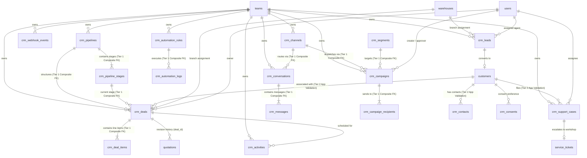

# InoManage Cloud Multi-Tenant SaaS ERP
# CRM Database Design & Entity Relationship Specifications

**Document Version:** 2.1.0  
**Phase:** Stage 2 CRM, Gate 0: Architecture & Design Revision 2.1 (Final Security Reconciliation)  
**Classification:** Technical Database Specification  
**Path:** `docs/crm/CRM_DATABASE_DESIGN.md`

---

## 1. High-Level Entity Relationship Diagram (ERD)

The following Mermaid diagram outlines the 18 CRM domain entities, their relationships with one another, and their foreign key touchpoints to existing core ERP tables (`teams`, `users`, `customers`, `warehouses`, `quotations`, `service_tickets`).

---

## 2. Foreign Key Strategy: Two-Tiered Tenant Isolation

To prevent cross-tenant referencing, the CRM database architecture establishes a strict two-tiered foreign key protocol:

### 2.1 Tier 1: Internal CRM-to-CRM Composite Foreign Keys
Parent CRM tables define a composite unique index on `(team_id, id)`. Child CRM tables enforce a **composite foreign key** referencing both `team_id` and `id`.

**Applied Tier 1 Composite Foreign Keys:**
* `crm_pipeline_stages (team_id, pipeline_id) -> crm_pipelines (team_id, id)` ON DELETE CASCADE
* `crm_deals (team_id, pipeline_id) -> crm_pipelines (team_id, id)` ON DELETE RESTRICT
* `crm_deals (team_id, stage_id) -> crm_pipeline_stages (team_id, id)` ON DELETE RESTRICT
* `crm_deal_items (team_id, deal_id) -> crm_deals (team_id, id)` ON DELETE CASCADE
* `crm_conversations (team_id, channel_id) -> crm_channels (team_id, id)` ON DELETE CASCADE
* `crm_messages (team_id, conversation_id) -> crm_conversations (team_id, id)` ON DELETE CASCADE
* `crm_campaigns (team_id, channel_id) -> crm_channels (team_id, id)` ON DELETE RESTRICT
* `crm_campaigns (team_id, segment_id) -> crm_segments (team_id, id)` ON DELETE SET NULL
* `crm_campaign_recipients (team_id, campaign_id) -> crm_campaigns (team_id, id)` ON DELETE CASCADE
* `crm_automation_logs (team_id, rule_id) -> crm_automation_rules (team_id, id)` ON DELETE CASCADE

*Engine Guarantee:* MySQL InnoDB rejects any attempt to insert a child record with a `team_id` that does not match the parent's `team_id`.

### 2.2 Tier 2: CRM-to-ERP Foreign Keys (Centralized Application Validation)
Existing core ERP tables (`customers`, `warehouses`, `quotations`, `service_tickets`) only define a single-column primary key `id` and lack composite unique indexes on `(team_id, id)`. In addition, `users` is a global table without a `team_id` column (memberships are recorded in `team_user` / `Membership`).

**Security Safeguards for Tier 2 References:**
1. **Database Level:** Standard single-column foreign keys `FOREIGN KEY (parent_id) REFERENCES erp_table(id) ON DELETE [CASCADE|SET NULL]`.
2. **Centralized Service Level (`TenantBoundaryValidator`):**
   Before saving or executing transactions, domain actions call `TenantBoundaryValidator`:
   * Validates `customer_id` belongs to active `team_id`.
   * Validates `warehouse_id` belongs to active `team_id` and is active.
   * Validates `quotation_id` belongs to active `team_id`.
   * Validates `service_ticket_id` belongs to active `team_id`.
   * Validates `assigned_user_id` has an active `Membership` in `team_user` for the active `team_id`.
3. **Bulk Operation Safeguards:** Direct database mass-updates (`DB::table()->update()`, `Model::insert()`) bypass Eloquent model hooks. Therefore, all CRM bulk operations must execute through dedicated Action/Repository classes that enforce explicit `WHERE team_id = ?` scopes on all update targets and join dependencies.
4. **Concurrency Safeguards:** Critical status transitions (lead conversion, deal won to quotation generation, campaign dispatch) must obtain pessimistic locks (`lockForUpdate()`) inside database transactions.
5. **Automated Penetration Tests:** Explicit tests attempt cross-tenant referencing for each foreign key and assert immediate rejection.

### 2.3 Polymorphic Relationship Invariants
Four CRM tables utilize polymorphic relationships where foreign keys cannot be enforced by the relational engine:
* `crm_conversations`: `(counterparty_type, counterparty_id)` -> must reference `App\Models\Customer` or `App\Modules\Crm\Models\CrmLead`.
* `crm_activities`: `(related_type, related_id)` -> must reference `lead`, `deal`, `customer`, or `case`.
* `crm_campaign_recipients`: `(recipient_type, recipient_id)` -> must reference `customer`, `lead`, or `contact`.
* `crm_automation_logs`: `(target_type, target_id)` -> must reference an allowlisted CRM entity.

*Rule:* In all polymorphic relationships, `TenantBoundaryValidator::validatePolymorphicTarget($teamId, $type, $id)` resolves the target model and asserts `target->team_id === $teamId`.

---

## 3. Table Specifications & Schema Definitions (18 Tables)

---

### 3.1 `crm_channels` (Tenant Communication Configurations)
Stores tenant integration credentials for WhatsApp, SMS, and Email.

| Column | Type | Attributes | Description |
| :--- | :--- | :--- | :--- |
| `id` | BIGINT UNSIGNED | PK, AUTO_INCREMENT | Primary key |
| `team_id` | BIGINT UNSIGNED | NOT NULL, INDEX | Foreign key to `teams.id` |
| `channel_type` | ENUM | NOT NULL | Values: `'whatsapp'`, `'sms'`, `'email'` |
| `name` | VARCHAR(100) | NOT NULL | Channel display name (e.g., Support WA) |
| `provider` | VARCHAR(50) | NOT NULL | `'meta_cloud'`, `'bulksmsbd'`, `'tenant_smtp'` |
| `identifier` | VARCHAR(150) | NOT NULL | Phone number, Sender ID, or Email address |
| `webhook_token` | VARCHAR(100) | NULL | Webhook verification token |
| `credentials` | TEXT | NOT NULL | Encrypted JSON (`Crypt::encryptString`) |
| `is_default` | BOOLEAN | NOT NULL, DEFAULT 0 | Default outbound channel for type |
| `is_active` | BOOLEAN | NOT NULL, DEFAULT 1 | Active status |
| `last_synced_at` | TIMESTAMP | NULL | Health check timestamp |
| `created_at` / `updated_at` | TIMESTAMP | NULL | Standard timestamps |

**Indexes & Constraints:**
* `UNIQUE (team_id, channel_type, identifier)`
* `UNIQUE (team_id, id)` *(Parent unique index for composite foreign key)*
* `FOREIGN KEY (team_id) REFERENCES teams(id) ON DELETE CASCADE`

---

### 3.2 `crm_webhook_events` (Durable Webhook Audit & Replay Protection)
Stores raw incoming webhook payloads for idempotency, replay defense, and audit logging.

| Column | Type | Attributes | Description |
| :--- | :--- | :--- | :--- |
| `id` | BIGINT UNSIGNED | PK, AUTO_INCREMENT | Primary key |
| `team_id` | BIGINT UNSIGNED | NULL, INDEX | Resolved `teams.id` (null if unmatched) |
| `provider` | VARCHAR(50) | NOT NULL | `'meta_whatsapp'`, `'bulksmsbd'` |
| `event_scope_key` | VARCHAR(100) | NOT NULL, DEFAULT 'global' | Normalized event scope identifier: `'global'` for global scope, or provider-account identifier for account-scoped gateways |
| `external_event_id`| VARCHAR(191)| NOT NULL, INDEX | Normalized provider event/message/callback identifier |
| `payload_hash` | VARCHAR(64) | NOT NULL, INDEX | SHA-256 hash of raw payload |
| `headers` | JSON | NULL | HTTP request headers (sensitive auth redacted) |
| `payload` | LONGTEXT | NOT NULL | Raw request body |
| `status` | ENUM | NOT NULL, DEFAULT 'pending' | `'pending'`, `'processed'`, `'failed'`, `'duplicate'`, `'unmatched_channel'` |
| `error_details` | TEXT | NULL | Processing error message |
| `processed_at` | TIMESTAMP | NULL | Execution timestamp |
| `created_at` | TIMESTAMP | NOT NULL | Ingress timestamp |

**Indexes & Constraints:**
* **Normalized Event Identity Strategy:**
  * Deduplication and replay defense enforce a composite unique key: `UNIQUE (provider, event_scope_key, external_event_id)`.
  * **Global Scope:** For globally unique provider identifiers, `event_scope_key` uses a stable global scope identifier (`'global'`).
  * **Account Scope:** For identifiers that are unique only within an account or channel (e.g. SMS aggregators), `event_scope_key` uses a stable provider-account identifier (e.g. `waba_id`, `phone_number_id`, or `bulksmsbd_sender_id`).
  * **Payload Identity Semantics:** Ingestion logic validates payload semantics rather than assuming Meta WhatsApp WAMID is a top-level webhook event ID. Meta webhook POST requests deliver batches of change objects under `entry[].changes[].value` containing messages (`messages[].id`) or status receipts (`statuses[].id`). Ingress parses and normalizes individual event items before staging.
  * **Concurrency & Deduplication:** Concurrent duplicate deliveries are blocked by the database unique constraint; competing threads catch the duplicate key exception, mark status as `'duplicate'`, and return HTTP 200 without dispatching duplicate background jobs.
* `INDEX (provider, payload_hash)`
* `INDEX (team_id, status)`
* `INDEX (created_at)` *(Supports 30-day purge pruning)*

---

### 3.3 `crm_leads` (Prospective Counterparties)
Captures inbound marketing and sales leads prior to customer qualification.

| Column | Type | Attributes | Description |
| :--- | :--- | :--- | :--- |
| `id` | BIGINT UNSIGNED | PK, AUTO_INCREMENT | Internal primary key |
| `team_id` | BIGINT UNSIGNED | NOT NULL, INDEX | Foreign key to `teams.id` |
| `lead_number` | VARCHAR(50) | NOT NULL | Human-readable ID (e.g., `LED-2026-0001`) |
| `type` | ENUM | NOT NULL, DEFAULT 'b2b' | Values: `'b2b'`, `'b2c'` |
| `title` | VARCHAR(100) | NULL | Lead honorific/job title |
| `first_name` | VARCHAR(100) | NOT NULL | First name |
| `last_name` | VARCHAR(100) | NULL | Last name |
| `company_name` | VARCHAR(150) | NULL | Company name for B2B |
| `email` | VARCHAR(150) | NULL, INDEX | Primary email address |
| `phone` | VARCHAR(50) | NOT NULL, INDEX | Primary phone (normalized E.164) |
| `secondary_phone`| VARCHAR(50) | NULL | Alternate contact number |
| `source` | VARCHAR(50) | NOT NULL, DEFAULT 'manual'| `web`, `whatsapp`, `phone`, `walk_in`, `referral` |
| `status` | VARCHAR(30) | NOT NULL, DEFAULT 'new' | `new`, `contacted`, `qualified`, `unqualified`, `converted` |
| `score` | SMALLINT | NOT NULL, DEFAULT 0 | Lead score (0 to 100) |
| `estimated_budget`| DECIMAL(15,2)| NULL | Estimated opportunity value |
| `warehouse_id` | BIGINT UNSIGNED | NULL, INDEX | Branch assignment foreign key to `warehouses.id` |
| `assigned_user_id`| BIGINT UNSIGNED | NULL, INDEX | Assigned sales rep (`users.id`) |
| `converted_customer_id` | BIGINT UNSIGNED | NULL, INDEX | Linked `customers.id` upon conversion |
| `converted_deal_id` | BIGINT UNSIGNED | NULL, INDEX | Linked `crm_deals.id` upon conversion |
| `converted_at` | TIMESTAMP | NULL | Timestamp of qualification/conversion |
| `disqualification_reason` | VARCHAR(255) | NULL | Reason if marked unqualified |
| `created_by` | BIGINT UNSIGNED | NULL | Creator `users.id` |
| `created_at` / `updated_at` | TIMESTAMP | NULL | Standard audit timestamps |

**Indexes & Constraints:**
* `UNIQUE (team_id, lead_number)`
* `UNIQUE (team_id, id)` *(Parent unique index for composite foreign key)*
* `INDEX (team_id, phone)`
* `INDEX (team_id, email)`
* `INDEX (team_id, status)`
* `FOREIGN KEY (team_id) REFERENCES teams(id) ON DELETE CASCADE`
* `FOREIGN KEY (warehouse_id) REFERENCES warehouses(id) ON DELETE SET NULL`
* `FOREIGN KEY (assigned_user_id) REFERENCES users(id) ON DELETE SET NULL`
* `FOREIGN KEY (converted_customer_id) REFERENCES customers(id) ON DELETE SET NULL`

---

### 3.4 `crm_contacts` (Multi-Stakeholder B2B Contacts)
Allows multiple contacts under an ERP `Customer` entity (e.g., Accounts, Billing, Procurement).

| Column | Type | Attributes | Description |
| :--- | :--- | :--- | :--- |
| `id` | BIGINT UNSIGNED | PK, AUTO_INCREMENT | Internal primary key |
| `team_id` | BIGINT UNSIGNED | NOT NULL, INDEX | Foreign key to `teams.id` |
| `customer_id` | BIGINT UNSIGNED | NOT NULL, INDEX | Foreign key to `customers.id` (Parent Account) |
| `first_name` | VARCHAR(100) | NOT NULL | Contact person's first name |
| `last_name` | VARCHAR(100) | NULL | Contact person's last name |
| `job_title` | VARCHAR(100) | NULL | Title/Role (e.g., Purchasing Officer) |
| `department` | VARCHAR(100) | NULL | Department (e.g., Finance, Tech) |
| `email` | VARCHAR(150) | NULL, INDEX | Direct email address |
| `phone` | VARCHAR(50) | NOT NULL, INDEX | Direct phone (E.164) |
| `mobile` | VARCHAR(50) | NULL | Mobile/WhatsApp number |
| `is_primary` | BOOLEAN | NOT NULL, DEFAULT 0 | Primary point of contact flag |
| `is_billing` | BOOLEAN | NOT NULL, DEFAULT 0 | Recipient of invoices and dues notices |
| `created_at` / `updated_at` | TIMESTAMP | NULL | Standard timestamps |

**Indexes & Constraints:**
* `UNIQUE (team_id, id)` *(Parent unique index for composite foreign key)*
* `INDEX (team_id, customer_id)`
* `INDEX (team_id, phone)`
* `INDEX (team_id, email)`
* `FOREIGN KEY (team_id) REFERENCES teams(id) ON DELETE CASCADE`
* `FOREIGN KEY (customer_id) REFERENCES customers(id) ON DELETE CASCADE`

---

### 3.5 `crm_pipelines` & `crm_pipeline_stages` (Sales Funnels)

#### `crm_pipelines`
| Column | Type | Attributes | Description |
| :--- | :--- | :--- | :--- |
| `id` | BIGINT UNSIGNED | PK, AUTO_INCREMENT | Primary key |
| `team_id` | BIGINT UNSIGNED | NOT NULL, INDEX | Foreign key to `teams.id` |
| `name` | VARCHAR(100) | NOT NULL | Pipeline Name (e.g., Standard Sales, B2B Enterprise) |
| `slug` | VARCHAR(100) | NOT NULL | URL-safe slug |
| `is_default` | BOOLEAN | NOT NULL, DEFAULT 0 | Default pipeline for new deals |
| `is_active` | BOOLEAN | NOT NULL, DEFAULT 1 | Active state |
| `created_at` / `updated_at` | TIMESTAMP | NULL | Timestamps |

**Indexes & Constraints:**
* `UNIQUE (team_id, slug)`
* `UNIQUE (team_id, id)` *(Parent unique index for composite foreign key)*
* `FOREIGN KEY (team_id) REFERENCES teams(id) ON DELETE CASCADE`

#### `crm_pipeline_stages`
| Column | Type | Attributes | Description |
| :--- | :--- | :--- | :--- |
| `id` | BIGINT UNSIGNED | PK, AUTO_INCREMENT | Primary key |
| `team_id` | BIGINT UNSIGNED | NOT NULL, INDEX | Foreign key to `teams.id` |
| `pipeline_id` | BIGINT UNSIGNED | NOT NULL, INDEX | Foreign key to `crm_pipelines.id` |
| `name` | VARCHAR(100) | NOT NULL | Stage Name (e.g., Discovery, Proposal, Negotiation) |
| `probability` | SMALLINT | NOT NULL, DEFAULT 10 | Closing probability % (0 - 100) |
| `stage_order` | SMALLINT | NOT NULL, DEFAULT 1 | Position in pipeline sequence |
| `is_won_stage` | BOOLEAN | NOT NULL, DEFAULT 0 | Marks deals as Won |
| `is_lost_stage` | BOOLEAN | NOT NULL, DEFAULT 0 | Marks deals as Lost |
| `created_at` / `updated_at` | TIMESTAMP | NULL | Timestamps |

**Indexes & Constraints:**
* `UNIQUE (team_id, id)` *(Parent unique index for composite foreign key)*
* `INDEX (team_id, pipeline_id, stage_order)`
* `FOREIGN KEY (team_id, pipeline_id) REFERENCES crm_pipelines(team_id, id) ON DELETE CASCADE` *(Tier 1 Composite FK)*

---

### 3.6 `crm_deals` & `crm_deal_items` (Opportunities & Line Items)

#### `crm_deals`
| Column | Type | Attributes | Description |
| :--- | :--- | :--- | :--- |
| `id` | BIGINT UNSIGNED | PK, AUTO_INCREMENT | Primary key |
| `team_id` | BIGINT UNSIGNED | NOT NULL, INDEX | Foreign key to `teams.id` |
| `deal_number` | VARCHAR(50) | NOT NULL | Formatted Deal ID (e.g., `DEL-2026-0042`) |
| `title` | VARCHAR(200) | NOT NULL | Opportunity title |
| `customer_id` | BIGINT UNSIGNED | NOT NULL, INDEX | Foreign key to `customers.id` |
| `contact_id` | BIGINT UNSIGNED | NULL, INDEX | Optional key to `crm_contacts.id` |
| `pipeline_id` | BIGINT UNSIGNED | NOT NULL, INDEX | Foreign key to `crm_pipelines.id` |
| `stage_id` | BIGINT UNSIGNED | NOT NULL, INDEX | Foreign key to `crm_pipeline_stages.id` |
| `value` | DECIMAL(15,2)| NOT NULL, DEFAULT 0.00 | Deal gross currency value |
| `currency` | VARCHAR(3) | NOT NULL, DEFAULT 'BDT' | Currency ISO code |
| `expected_close_date` | DATE | NULL | Projected closing date |
| `actual_close_date` | DATE | NULL | Date marked Won/Lost |
| `win_loss_reason` | VARCHAR(255) | NULL | Qualitative explanation for outcome |
| `assigned_user_id` | BIGINT UNSIGNED | NULL, INDEX | Assigned sales representative (`users.id`) |
| `warehouse_id` | BIGINT UNSIGNED | NULL, INDEX | Branch attribution (`warehouses.id`) |
| `lead_id` | BIGINT UNSIGNED | NULL, INDEX | Source lead (`crm_leads.id`) |
| `quotation_id` | BIGINT UNSIGNED | NULL, INDEX | Active ERP `quotations.id` |
| `created_by` | BIGINT UNSIGNED | NULL | Creator user ID |
| `created_at` / `updated_at` | TIMESTAMP | NULL | Standard audit timestamps |

**Indexes & Constraints:**
* `UNIQUE (team_id, deal_number)`
* `UNIQUE (team_id, id)` *(Parent unique index for composite foreign key)*
* `INDEX (team_id, customer_id)`
* `INDEX (team_id, stage_id)`
* `INDEX (team_id, assigned_user_id)`
* `INDEX (team_id, warehouse_id)`
* `FOREIGN KEY (team_id) REFERENCES teams(id) ON DELETE CASCADE`
* `FOREIGN KEY (customer_id) REFERENCES customers(id) ON DELETE CASCADE` *(Tier 2 with App Validation)*
* `FOREIGN KEY (team_id, pipeline_id) REFERENCES crm_pipelines(team_id, id) ON DELETE RESTRICT` *(Tier 1 Composite FK)*
* `FOREIGN KEY (team_id, stage_id) REFERENCES crm_pipeline_stages(team_id, id) ON DELETE RESTRICT` *(Tier 1 Composite FK)*
* `FOREIGN KEY (assigned_user_id) REFERENCES users(id) ON DELETE SET NULL`
* `FOREIGN KEY (warehouse_id) REFERENCES warehouses(id) ON DELETE SET NULL`

#### `crm_deal_items` (Opportunity Line Items)
Tracks proposed products and pricing directly on the deal prior to quotation generation.

| Column | Type | Attributes | Description |
| :--- | :--- | :--- | :--- |
| `id` | BIGINT UNSIGNED | PK, AUTO_INCREMENT | Primary key |
| `team_id` | BIGINT UNSIGNED | NOT NULL, INDEX | Foreign key to `teams.id` |
| `deal_id` | BIGINT UNSIGNED | NOT NULL, INDEX | Foreign key to `crm_deals.id` |
| `product_id` | BIGINT UNSIGNED | NULL, INDEX | Foreign key to ERP `products.id` |
| `item_name` | VARCHAR(200) | NOT NULL | Item or service description |
| `quantity` | DECIMAL(12,2)| NOT NULL, DEFAULT 1.00 | Proposed quantity |
| `unit_price` | DECIMAL(15,2)| NOT NULL, DEFAULT 0.00 | Proposed unit price |
| `subtotal` | DECIMAL(15,2)| NOT NULL, DEFAULT 0.00 | Line total (`quantity * unit_price`) |
| `notes` | VARCHAR(255) | NULL | Item specifications or discounts |
| `created_at` / `updated_at` | TIMESTAMP | NULL | Timestamps |

**Indexes & Constraints:**
* `INDEX (team_id, deal_id)`
* `FOREIGN KEY (team_id, deal_id) REFERENCES crm_deals(team_id, id) ON DELETE CASCADE` *(Tier 1 Composite FK)*
* `FOREIGN KEY (product_id) REFERENCES products(id) ON DELETE SET NULL`

---

### 3.7 `crm_conversations` & `crm_messages` (Unified Omnichannel Inbox)

#### `crm_conversations`
| Column | Type | Attributes | Description |
| :--- | :--- | :--- | :--- |
| `id` | BIGINT UNSIGNED | PK, AUTO_INCREMENT | Primary key |
| `team_id` | BIGINT UNSIGNED | NOT NULL, INDEX | Foreign key to `teams.id` |
| `channel_id` | BIGINT UNSIGNED | NOT NULL, INDEX | Foreign key to `crm_channels.id` |
| `counterparty_type`| VARCHAR(50) | NOT NULL | Morph type: `'customer'`, `'lead'` |
| `counterparty_id` | BIGINT UNSIGNED | NOT NULL | Morph ID |
| `remote_identifier`| VARCHAR(150) | NOT NULL | Remote phone (E.164) or email address |
| `subject` | VARCHAR(255) | NULL | Optional subject (email threads) |
| `status` | ENUM | NOT NULL, DEFAULT 'open'| `'open'`, `'pending'`, `'closed'` |
| `assigned_user_id` | BIGINT UNSIGNED | NULL, INDEX | Assigned agent (`users.id`) |
| `last_message_at` | TIMESTAMP | NULL, INDEX | Sorting timestamp |
| `created_at` / `updated_at` | TIMESTAMP | NULL | Standard timestamps |

**Indexes & Constraints:**
* `UNIQUE (team_id, id)` *(Parent unique index for composite foreign key)*
* `INDEX (team_id, counterparty_type, counterparty_id)`
* `INDEX (team_id, remote_identifier)`
* `INDEX (team_id, channel_id, last_message_at)`
* `FOREIGN KEY (team_id) REFERENCES teams(id) ON DELETE CASCADE`
* `FOREIGN KEY (team_id, channel_id) REFERENCES crm_channels(team_id, id) ON DELETE CASCADE` *(Tier 1 Composite FK)*

#### `crm_messages`
| Column | Type | Attributes | Description |
| :--- | :--- | :--- | :--- |
| `id` | BIGINT UNSIGNED | PK, AUTO_INCREMENT | Primary key |
| `team_id` | BIGINT UNSIGNED | NOT NULL, INDEX | Foreign key to `teams.id` |
| `conversation_id` | BIGINT UNSIGNED | NOT NULL, INDEX | Foreign key to `crm_conversations.id` |
| `direction` | ENUM | NOT NULL | `'inbound'`, `'outbound'` |
| `channel_type` | ENUM | NOT NULL | `'whatsapp'`, `'sms'`, `'email'` |
| `sender_type` | VARCHAR(50) | NOT NULL | `'user'`, `'customer'`, `'system'` |
| `sender_id` | BIGINT UNSIGNED | NULL | ID of sender user or null |
| `external_id` | VARCHAR(191) | NULL, INDEX | Provider ID (e.g. Meta WAMID, BulkSMSBD MsgID) |
| `body` | TEXT | NOT NULL | Text body content |
| `attachments` | JSON | NULL | Array of attachment metadata (paths, mime, hashes) |
| `delivery_status` | ENUM | NOT NULL, DEFAULT 'queued'| `'queued'`, `'sent'`, `'delivered'`, `'read'`, `'failed'` |
| `error_message` | TEXT | NULL | Provider rejection code/reason |
| `sent_at` | TIMESTAMP | NULL | Outbound dispatch timestamp |
| `delivered_at` | TIMESTAMP | NULL | Delivery receipt timestamp |
| `read_at` | TIMESTAMP | NULL | Read receipt timestamp |
| `created_at` / `updated_at` | TIMESTAMP | NULL | Timestamps |

**Indexes & Constraints:**
* `INDEX (team_id, conversation_id, created_at)`
* `UNIQUE (team_id, channel_type, external_id)` *(Provider-scoped message idempotency)*
* `FOREIGN KEY (team_id, conversation_id) REFERENCES crm_conversations(team_id, id) ON DELETE CASCADE` *(Tier 1 Composite FK)*

---

### 3.8 `crm_campaigns` & `crm_campaign_recipients` (Marketing Dispatches)

#### `crm_campaigns`
| Column | Type | Attributes | Description |
| :--- | :--- | :--- | :--- |
| `id` | BIGINT UNSIGNED | PK, AUTO_INCREMENT | Primary key |
| `team_id` | BIGINT UNSIGNED | NOT NULL, INDEX | Foreign key to `teams.id` |
| `campaign_code` | VARCHAR(50) | NOT NULL | Human-readable code (`CMP-2026-001`) |
| `name` | VARCHAR(150) | NOT NULL | Campaign name |
| `channel_type` | ENUM | NOT NULL | `'whatsapp'`, `'sms'`, `'email'` |
| `channel_id` | BIGINT UNSIGNED | NOT NULL, INDEX | Configured channel `crm_channels.id` |
| `segment_id` | BIGINT UNSIGNED | NULL, INDEX | Target cohort `crm_segments.id` |
| `message_template`| TEXT | NOT NULL | Message template with variables (`{name}`, etc.) |
| `status` | ENUM | NOT NULL, DEFAULT 'draft'| `'draft'`, `'pending_approval'`, `'approved'`, `'rejected'`, `'queued'`, `'dispatching'`, `'completed'`, `'cancelled'` |
| `scheduled_at` | TIMESTAMP | NULL | Optional scheduled dispatch time |
| `total_recipients`| INT UNSIGNED | NOT NULL, DEFAULT 0 | Count of targeted recipients |
| `sent_count` | INT UNSIGNED | NOT NULL, DEFAULT 0 | Count of successfully dispatched |
| `failed_count` | INT UNSIGNED | NOT NULL, DEFAULT 0 | Count of failed dispatches |
| `created_by` | BIGINT UNSIGNED | NOT NULL, INDEX | Campaign author `users.id` |
| `approved_by` | BIGINT UNSIGNED | NULL, INDEX | Authorizing manager `users.id` |
| `approved_at` | TIMESTAMP | NULL | Timestamp of approval |
| `rejection_reason`| VARCHAR(255) | NULL | Reason if rejected |
| `created_at` / `updated_at` | TIMESTAMP | NULL | Standard timestamps |

**Indexes & Constraints:**
* `UNIQUE (team_id, campaign_code)`
* `UNIQUE (team_id, id)` *(Parent unique index for composite foreign key)*
* `INDEX (team_id, status)`
* `FOREIGN KEY (team_id) REFERENCES teams(id) ON DELETE CASCADE`
* `FOREIGN KEY (team_id, channel_id) REFERENCES crm_channels(team_id, id) ON DELETE RESTRICT` *(Tier 1 Composite FK)*
* `FOREIGN KEY (team_id, segment_id) REFERENCES crm_segments(team_id, id) ON DELETE SET NULL` *(Tier 1 Composite FK)*
* `FOREIGN KEY (created_by) REFERENCES users(id) ON DELETE RESTRICT`
* `FOREIGN KEY (approved_by) REFERENCES users(id) ON DELETE SET NULL`

#### `crm_campaign_recipients`
| Column | Type | Attributes | Description |
| :--- | :--- | :--- | :--- |
| `id` | BIGINT UNSIGNED | PK, AUTO_INCREMENT | Primary key |
| `team_id` | BIGINT UNSIGNED | NOT NULL, INDEX | Foreign key to `teams.id` |
| `campaign_id` | BIGINT UNSIGNED | NOT NULL, INDEX | Foreign key to `crm_campaigns.id` |
| `recipient_type` | VARCHAR(50) | NOT NULL | `'customer'`, `'lead'`, `'contact'` |
| `recipient_id` | BIGINT UNSIGNED | NOT NULL | Target entity ID |
| `destination` | VARCHAR(150) | NOT NULL | Phone number or email address |
| `status` | ENUM | NOT NULL, DEFAULT 'pending'| `'pending'`, `'sent'`, `'delivered'`, `'failed'`, `'suppressed'` |
| `external_id` | VARCHAR(191) | NULL, INDEX | Provider message reference |
| `error_details` | VARCHAR(255) | NULL | Failure explanation |
| `dispatched_at` | TIMESTAMP | NULL | Execution timestamp |
| `created_at` / `updated_at` | TIMESTAMP | NULL | Standard timestamps |

**Indexes & Constraints:**
* `UNIQUE (campaign_id, destination)` *(Prevents duplicate dispatches)*
* `INDEX (team_id, campaign_id, status)`
* `FOREIGN KEY (team_id, campaign_id) REFERENCES crm_campaigns(team_id, id) ON DELETE CASCADE` *(Tier 1 Composite FK)*

---

### 3.9 `crm_segments` & `crm_consents` (Targeting & Regulatory Consent)

#### `crm_segments`
| Column | Type | Attributes | Description |
| :--- | :--- | :--- | :--- |
| `id` | BIGINT UNSIGNED | PK, AUTO_INCREMENT | Primary key |
| `team_id` | BIGINT UNSIGNED | NOT NULL, INDEX | Foreign key to `teams.id` |
| `name` | VARCHAR(100) | NOT NULL | Segment Name (e.g., VIP Retail, Inactive 90 Days) |
| `type` | ENUM | NOT NULL, DEFAULT 'dynamic'| `'dynamic'`, `'static'` |
| `filter_criteria`| JSON | NULL | JSON rules for dynamic query evaluation |
| `member_count` | INT UNSIGNED | NOT NULL, DEFAULT 0 | Cached count of matching entities |
| `created_at` / `updated_at` | TIMESTAMP | NULL | Timestamps |

**Indexes & Constraints:**
* `UNIQUE (team_id, id)` *(Parent unique index for composite foreign key)*
* `INDEX (team_id, name)`
* `FOREIGN KEY (team_id) REFERENCES teams(id) ON DELETE CASCADE`

#### `crm_consents` (Opt-In Evidence & Regulatory DND Registry)
| Column | Type | Attributes | Description |
| :--- | :--- | :--- | :--- |
| `id` | BIGINT UNSIGNED | PK, AUTO_INCREMENT | Primary key |
| `team_id` | BIGINT UNSIGNED | NOT NULL, INDEX | Foreign key to `teams.id` |
| `channel_type` | ENUM | NOT NULL | `'whatsapp'`, `'sms'`, `'email'` |
| `destination` | VARCHAR(150) | NOT NULL | Phone or email address |
| `status` | ENUM | NOT NULL, DEFAULT 'opted_in'| `'opted_in'`, `'opted_out'`, `'dnd_national'` |
| `purpose` | VARCHAR(50) | NOT NULL, DEFAULT 'marketing'| `'marketing'`, `'transactional'`, `'service_alert'` |
| `source` | VARCHAR(50) | NOT NULL | `'web_form'`, `'pos_receipt'`, `'keyword_stop'`, `'manual_agent'`, `'btrc_dnd'` |
| `opt_in_evidence`| TEXT | NULL | Consent text, IP address, or proof string |
| `opted_out_at` | TIMESTAMP | NULL | Timestamp of opt-out |
| `created_at` / `updated_at` | TIMESTAMP | NULL | Timestamps |

**Indexes & Constraints:**
* `UNIQUE (team_id, channel_type, destination, purpose)`
* `INDEX (team_id, destination)`
* `FOREIGN KEY (team_id) REFERENCES teams(id) ON DELETE CASCADE`

---

### 3.10 `crm_support_cases` (Customer Service & Inquiries)
Tracks non-workshop customer tickets, complaints, and SLA lifecycles.

| Column | Type | Attributes | Description |
| :--- | :--- | :--- | :--- |
| `id` | BIGINT UNSIGNED | PK, AUTO_INCREMENT | Primary key |
| `team_id` | BIGINT UNSIGNED | NOT NULL, INDEX | Foreign key to `teams.id` |
| `case_number` | VARCHAR(50) | NOT NULL | Formatted ID (`CAS-2026-0010`) |
| `customer_id` | BIGINT UNSIGNED | NOT NULL, INDEX | Foreign key to `customers.id` |
| `contact_id` | BIGINT UNSIGNED | NULL, INDEX | Optional contact `crm_contacts.id` |
| `subject` | VARCHAR(200) | NOT NULL | Case summary |
| `description` | TEXT | NOT NULL | Detailed inquiry/problem |
| `category` | VARCHAR(50) | NOT NULL | `'billing'`, `'product_inquiry'`, `'delivery'`, `'technical'` |
| `priority` | ENUM | NOT NULL, DEFAULT 'medium' | `'low'`, `'medium'`, `'high'`, `'urgent'` |
| `status` | ENUM | NOT NULL, DEFAULT 'open' | `'open'`, `'in_progress'`, `'pending_customer'`, `'resolved'`, `'closed'` |
| `sla_due_at` | TIMESTAMP | NULL | Target resolution time |
| `resolved_at` | TIMESTAMP | NULL | Actual resolution timestamp |
| `assigned_user_id`| BIGINT UNSIGNED | NULL, INDEX | Assigned support agent (`users.id`) |
| `escalated_service_ticket_id`| BIGINT UNSIGNED | NULL, INDEX | Linked `service_tickets.id` (Workshop Repair) |
| `created_by` | BIGINT UNSIGNED | NULL | Creator user ID |
| `created_at` / `updated_at` | TIMESTAMP | NULL | Standard timestamps |

**Indexes & Constraints:**
* `UNIQUE (team_id, case_number)`
* `INDEX (team_id, customer_id)`
* `INDEX (team_id, status)`
* `INDEX (team_id, priority)`
* `FOREIGN KEY (team_id) REFERENCES teams(id) ON DELETE CASCADE`
* `FOREIGN KEY (customer_id) REFERENCES customers(id) ON DELETE CASCADE` *(Tier 2 with App Validation)*
* `FOREIGN KEY (assigned_user_id) REFERENCES users(id) ON DELETE SET NULL`
* `FOREIGN KEY (escalated_service_ticket_id) REFERENCES service_tickets(id) ON DELETE SET NULL` *(Tier 2 with App Validation)*

---

### 3.11 `crm_activities` (Tasks, Calls, Meetings)
Unified calendar and interaction journal for sales reps and account managers.

| Column | Type | Attributes | Description |
| :--- | :--- | :--- | :--- |
| `id` | BIGINT UNSIGNED | PK, AUTO_INCREMENT | Primary key |
| `team_id` | BIGINT UNSIGNED | NOT NULL, INDEX | Foreign key to `teams.id` |
| `type` | ENUM | NOT NULL | `'call'`, `'meeting'`, `'task'`, `'note'`, `'email'` |
| `subject` | VARCHAR(150) | NOT NULL | Activity headline |
| `description` | TEXT | NULL | Outcome notes / agenda |
| `related_type` | VARCHAR(50) | NOT NULL | Polymorphic type: `'lead'`, `'deal'`, `'customer'`, `'case'` |
| `related_id` | BIGINT UNSIGNED | NOT NULL | Target entity ID |
| `due_at` | TIMESTAMP | NULL, INDEX | Scheduled execution time |
| `completed_at` | TIMESTAMP | NULL | Completion timestamp |
| `assigned_user_id`| BIGINT UNSIGNED | NOT NULL, INDEX | Assigned staff member (`users.id`) |
| `created_by` | BIGINT UNSIGNED | NOT NULL | Creator `users.id` |
| `created_at` / `updated_at` | TIMESTAMP | NULL | Standard timestamps |

**Indexes & Constraints:**
* `INDEX (team_id, related_type, related_id)`
* `INDEX (team_id, assigned_user_id, due_at)`
* `FOREIGN KEY (team_id) REFERENCES teams(id) ON DELETE CASCADE`
* `FOREIGN KEY (assigned_user_id) REFERENCES users(id) ON DELETE CASCADE`

---

### 3.12 `crm_automation_rules` & `crm_automation_logs`

#### `crm_automation_rules`
| Column | Type | Attributes | Description |
| :--- | :--- | :--- | :--- |
| `id` | BIGINT UNSIGNED | PK, AUTO_INCREMENT | Primary key |
| `team_id` | BIGINT UNSIGNED | NOT NULL, INDEX | Foreign key to `teams.id` |
| `name` | VARCHAR(100) | NOT NULL | Rule Name (e.g., Auto-Welcome WhatsApp on Lead) |
| `event_trigger` | VARCHAR(100) | NOT NULL | Trigger event (`lead.created`, `deal.won`, `case.created`) |
| `conditions` | JSON | NULL | JSON rule conditions (e.g., `budget > 50000`) |
| `actions` | JSON | NOT NULL | JSON array of validated allowlisted operations |
| `is_active` | BOOLEAN | NOT NULL, DEFAULT 1 | Active switch |
| `created_at` / `updated_at` | TIMESTAMP | NULL | Timestamps |

*Allowlisted Automation Actions:*
`['assign_user', 'send_template_whatsapp', 'send_template_sms', 'send_template_email', 'change_stage', 'create_activity', 'add_tag']`

**Indexes & Constraints:**
* `UNIQUE (team_id, id)` *(Parent unique index for composite foreign key)*
* `FOREIGN KEY (team_id) REFERENCES teams(id) ON DELETE CASCADE`

#### `crm_automation_logs`
| Column | Type | Attributes | Description |
| :--- | :--- | :--- | :--- |
| `id` | BIGINT UNSIGNED | PK, AUTO_INCREMENT | Primary key |
| `team_id` | BIGINT UNSIGNED | NOT NULL, INDEX | Foreign key to `teams.id` |
| `rule_id` | BIGINT UNSIGNED | NOT NULL, INDEX | Foreign key to `crm_automation_rules.id` |
| `target_type` | VARCHAR(50) | NOT NULL | Target model class |
| `target_id` | BIGINT UNSIGNED | NOT NULL | Target entity ID |
| `execution_status`| ENUM | NOT NULL | `'success'`, `'failed'`, `'skipped'` |
| `log_output` | TEXT | NULL | Execution payload or failure message |
| `created_at` | TIMESTAMP | NOT NULL | Execution timestamp |

**Indexes & Constraints:**
* `INDEX (team_id, rule_id, created_at)`
* `FOREIGN KEY (team_id, rule_id) REFERENCES crm_automation_rules(team_id, id) ON DELETE CASCADE` *(Tier 1 Composite FK)*

---

## 4. Migration Execution Plan for Gate 1

The 18 tables will be deployed in a strictly ordered, dependency-verified migration sequence:
1. `2026_12_01_000001_create_crm_channels_table.php` *(defines UNIQUE(team_id, id))*
2. `2026_12_01_000002_create_crm_webhook_events_table.php`
3. `2026_12_01_000003_create_crm_leads_table.php`
4. `2026_12_01_000004_create_crm_contacts_table.php`
5. `2026_12_01_000005_create_crm_pipelines_and_stages_tables.php` *(defines UNIQUE(team_id, id) on pipelines & stages; composite FK to pipelines)*
6. `2026_12_01_000006_create_crm_deals_table.php` *(defines UNIQUE(team_id, id) on deals; composite FKs to pipelines & stages)*
7. `2026_12_01_000007_create_crm_deal_items_table.php` *(composite FK to deals)*
8. `2026_12_01_000008_create_crm_conversations_and_messages_tables.php` *(defines UNIQUE(team_id, id) on conversations; composite FKs to channels & conversations)*
9. `2026_12_01_000009_create_crm_segments_and_consents_tables.php` *(defines UNIQUE(team_id, id) on segments)*
10. `2026_12_01_000010_create_crm_campaigns_and_recipients_tables.php` *(defines UNIQUE(team_id, id) on campaigns; composite FKs to channels, segments, & campaigns)*
11. `2026_12_01_000011_create_crm_support_cases_table.php`
12. `2026_12_01_000012_create_crm_activities_table.php`
13. `2026_12_01_000013_create_crm_automation_tables.php` *(defines UNIQUE(team_id, id) on rules; composite FK to rules)*

---
*Next: Tenant isolation and webhook security architecture are detailed in `docs/crm/CRM_SECURITY_DESIGN.md`.*
