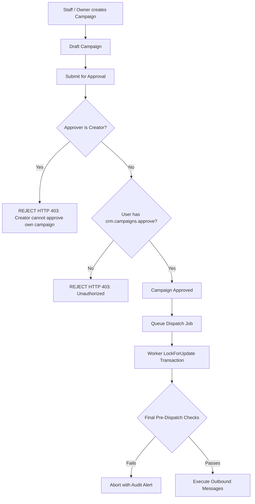

# InoManage Cloud Multi-Tenant SaaS ERP
# CRM Security Design & Ingress Hardening

**Document Version:** 2.1.0  
**Phase:** Stage 2 CRM, Gate 0: Architecture & Design Revision 2.1 (Final Security Reconciliation)  
**Classification:** Security Architecture Specification  
**Path:** `docs/crm/CRM_SECURITY_DESIGN.md`

---

## 1. Multi-Tenant Isolation Architecture

The CRM module completely adopts and extends the multi-tenant isolation guarantees established during **Stage 1 (Gates 1 through 5)**.

```
+-----------------------------------------------------------------------------------+
|                            Incoming Client / Webhook                              |
+-----------------------------------------------------------------------------------+
                                         |
                                         v
               +---------------------------------------------------+
               |             SetTenantContext Middleware           |
               |  - Identifies tenant from authenticated user      |
               |  - Or resolves tenant via webhook channel mapping |
               |  - Binds App\Services\TenantContext in container  |
               +---------------------------------------------------+
                                         |
                                         v
               +---------------------------------------------------+
               |            App\Traits\BelongsToTenant             |
               |  - Global Eloquent Scope: TenantScope             |
               |  - Automatically appends WHERE team_id = ?        |
               |  - Automatically stamps model->team_id on create  |
               |  - Implements \App\Contracts\TenantAware          |
               |  - Throws TenantContextMissingException if unset  |
               +---------------------------------------------------+
                                         |
                                         v
               +---------------------------------------------------+
               |                   MySQL Database                  |
               |  - Tier 1: Composite FKs (team_id, parent_id)     |
               |  - Tier 2: TenantBoundaryValidator for ERP FKs    |
               |  - Composite unique indexes (team_id, [code])     |
               +---------------------------------------------------+
```

### 1.1 Fail-Closed Tenancy Model
* **Model Integration:** Every CRM Eloquent model (`CrmLead`, `CrmDeal`, `CrmConversation`, `CrmCampaign`, `CrmSupportCase`, etc.) uses the canonical trait:
  ```php
  use App\Traits\BelongsToTenant;
  use App\Contracts\TenantAware;
  ```
* **Strict Fail-Closed Behavior:** If any CRM query, service, or job runs without an active `TenantContext`, `TenantScope` immediately raises a `TenantContextMissingException`, aborting the operation before SQL is issued to MySQL.

---

## 2. Foreign Key Security & Centralized Tenant Boundary Validation

To prevent cross-tenant referencing, the CRM enforces a two-tiered boundary strategy:

### 2.1 Tier 1: Internal CRM Composite Foreign Keys
All child CRM tables enforce composite foreign keys referencing `(team_id, id)` of their parent table:
```sql
FOREIGN KEY (`team_id`, `pipeline_id`) REFERENCES `crm_pipelines` (`team_id`, `id`) ON DELETE CASCADE
FOREIGN KEY (`team_id`, `pipeline_id`) REFERENCES `crm_pipelines` (`team_id`, `id`) ON DELETE RESTRICT
FOREIGN KEY (`team_id`, `stage_id`) REFERENCES `crm_pipeline_stages` (`team_id`, `id`) ON DELETE RESTRICT
FOREIGN KEY (`team_id`, `deal_id`) REFERENCES `crm_deals` (`team_id`, `id`) ON DELETE CASCADE
FOREIGN KEY (`team_id`, `channel_id`) REFERENCES `crm_channels` (`team_id`, `id`) ON DELETE CASCADE
FOREIGN KEY (`team_id`, `conversation_id`) REFERENCES `crm_conversations` (`team_id`, `id`) ON DELETE CASCADE
FOREIGN KEY (`team_id`, `channel_id`) REFERENCES `crm_channels` (`team_id`, `id`) ON DELETE RESTRICT
FOREIGN KEY (`team_id`, `segment_id`) REFERENCES `crm_segments` (`team_id`, `id`) ON DELETE SET NULL
FOREIGN KEY (`team_id`, `campaign_id`) REFERENCES `crm_campaigns` (`team_id`, `id`) ON DELETE CASCADE
FOREIGN KEY (`team_id`, `rule_id`) REFERENCES `crm_automation_rules` (`team_id`, `id`) ON DELETE CASCADE
```
*Engine Guarantee:* MySQL InnoDB enforces at the storage engine level that a child record cannot reference a parent record belonging to another tenant.

### 2.2 Tier 2: Centralized Application Validation (`TenantBoundaryValidator`)
Existing core ERP tables (`customers`, `warehouses`, `quotations`, `service_tickets`, `users`) lack composite unique indexes on `(team_id, id)` or do not have a `team_id` column (`users`).

*Centralized Defense Architecture:*
Instead of fragmented checks across controllers, all cross-tenant validation is centralized in `App\Modules\Crm\Services\TenantBoundaryValidator`:
```php
class TenantBoundaryValidator
{
    public function validateCustomer(int $teamId, ?int $customerId): void
    {
        if ($customerId && !Customer::where('team_id', $teamId)->where('id', $customerId)->exists()) {
            throw new TenantIsolationException("Referenced Customer does not belong to the active tenant.");
        }
    }

    public function validateWarehouse(int $teamId, ?int $warehouseId): void
    {
        if ($warehouseId && !Warehouse::where('team_id', $teamId)->where('is_active', true)->where('id', $warehouseId)->exists()) {
            throw new TenantIsolationException("Referenced Warehouse does not belong to the active tenant or is inactive.");
        }
    }

    public function validateAssignedUser(int $teamId, ?int $userId): void
    {
        if ($userId && !Membership::where('team_id', $teamId)->where('user_id', $userId)->exists()) {
            throw new TenantIsolationException("Assigned user is not an active member of the active tenant.");
        }
    }

    public function validatePolymorphicTarget(int $teamId, string $targetType, int $targetId): void
    {
        $allowedMap = [
            'customer' => Customer::class,
            'lead'     => CrmLead::class,
            'deal'     => CrmDeal::class,
            'case'     => CrmSupportCase::class,
            'contact'  => CrmContact::class,
        ];

        $modelClass = $allowedMap[$targetType] ?? null;
        if (!$modelClass || !$modelClass::where('team_id', $teamId)->where('id', $targetId)->exists()) {
            throw new TenantIsolationException("Polymorphic target does not belong to the active tenant.");
        }
    }
}
```

### 2.3 Bulk Operation, Update, Delete & Concurrency Safeguards
* **Bulk Operations Boundary:** Direct database batch operations (`DB::table()->update()`, `DB::table()->delete()`, `Model::insert()`) bypass Eloquent global scopes and model hooks. Supported CRM bulk operations must strictly pass through tenant-scoped Action/Repository boundaries that enforce explicit `WHERE team_id = ?` clauses. The architecture does not rely on Laravel to universally prevent raw SQL or direct DB queries from bypassing tenant filters; instead, strict code-review standards and automated repository contract tests enforce this boundary.
* **Concurrency Protection:** Critical state transitions (lead conversion, deal advancement to won, campaign dispatching) execute inside database transactions utilizing pessimistic row locks (`lockForUpdate()`) to prevent race conditions.

---

## 3. Webhook Ingress Architecture & Cryptographic Verification

### 3.1 Meta WhatsApp Cloud API Ingress Architecture
* **Meta App vs WABA Ownership:** The SaaS platform operates a single verified **Meta Developer App** registered with Meta for Business. Each tenant owns their legal **WhatsApp Business Account (WABA)** and phone number connected via **Meta Embedded Signup**.
* **Webhook Routing:** Meta delivers all incoming webhook events for all connected WABAs to the platform's central ingress URL (`POST /api/v1/crm/webhooks/whatsapp`).

#### Step 1: Platform Cryptographic Signature Verification
Because Meta sends events from the platform's app subscription, Meta signs the payload with the **Platform Meta App Secret** (`config('services.meta.app_secret')`), NOT the tenant access token:
```php
$signature = $request->header('X-Hub-Signature-256');
$expectedSignature = 'sha256=' . hash_hmac('sha256', $request->getContent(), config('services.meta.app_secret'));

if (!hash_equals($expectedSignature, (string)$signature)) {
    abort(403, 'Invalid webhook signature.');
}
```

#### Step 2: Durable Event Storage & Normalized Event Scope Key
Before tenant resolution or queue dispatch, the raw event is logged into `crm_webhook_events`:
* Headers are recorded with sensitive Authorization/Bearer tokens redacted.
* **Normalized Event Scope Key & Uniqueness:** Identity deduplication is enforced via `UNIQUE (provider, event_scope_key, external_event_id)`:
  - Global event identifiers use a stable global scope identifier (`event_scope_key = 'global'`).
  - Account-scoped identifiers use a stable provider-account identifier (e.g. `event_scope_key = provider_account_id`).
* **Payload Identity Validation:** Ingress logic validates payload structure and semantics rather than blindly assuming WhatsApp WAMID is a top-level webhook event ID. Meta delivers webhooks in nested arrays (`entry[].changes[].value`) containing incoming messages (`messages[].id`) or status updates (`statuses[].id`). Event ingestion extracts atomic event items, validates their identity semantics, and stages each with its corresponding scope key.
* **Concurrency & Duplicate Defense:** Concurrent duplicate deliveries are rejected at the database level by the unique constraint. The competing thread catches the duplicate key exception, records status as `'duplicate'`, and returns HTTP 200 without dispatching duplicate background jobs.

#### Step 3: Tenant Resolution & Unknown Channel Handling
The ingress controller parses `entry[].id` (WABA ID) and `entry[].changes[].value.metadata.phone_number_id` from the payload:
```php
$channel = CrmChannel::where('channel_type', 'whatsapp')
    ->where(function ($q) use ($phoneNumberId, $wabaId) {
        $q->where('identifier', $phoneNumberId)
          ->orWhereJsonContains('credentials->waba_id', $wabaId);
    })
    ->where('is_active', true)
    ->first();

if (!$channel) {
    // Record unmatched event safely; do NOT throw uncaught 500
    $webhookEvent->update(['status' => 'unmatched_channel']);
    Log::warning("Unmatched WhatsApp webhook event for Phone ID: {$phoneNumberId}");
    return response()->json(['status' => 'unmatched_channel'], 200);
}

$webhookEvent->update(['team_id' => $channel->team_id]);
```

#### Step 4: Webhook Retention & Pruning
A daily scheduled task (`crm:purge-webhook-events`) purges raw webhook events older than 30 days, preventing database bloat while maintaining a sufficient forensic audit window.

---

## 4. Queue Worker & SMTP Transport Isolation

Long-running queue workers (`php artisan queue:work`) retain PHP memory across jobs. Global configuration mutation introduces critical cross-tenant state pollution vulnerabilities.

### 4.1 Strict Transport Isolation Protocol
To guarantee that tenant SMTP credentials never leak across worker jobs:
1. **Zero Global Config Mutation:** Workers **must never** call `config(['mail.mailers.smtp => ...'])`.
2. **Dedicated Per-Tenant Symfony Mailer Transport with Explicit Shutdown and Cleanup:** `TenantMailService` instantiates a dedicated per-tenant Symfony Mailer transport (`Symfony\Component\Mailer\Transport\Smtp\EsmtpTransport`) dynamically for each tenant:
   ```php
   $transport = new EsmtpTransport(
       $channel->credentials['smtp_host'],
       (int) $channel->credentials['smtp_port'],
       $channel->credentials['smtp_encryption'] === 'tls'
   );
   $transport->setUsername($channel->credentials['smtp_username']);
   $transport->setPassword($channel->credentials['smtp_password']);

   $mailer = new \Symfony\Component\Mailer\Mailer($transport);
   $mailer->send($symfonyEmail);
   ```
3. **Mandatory Cleanup in `finally` Blocks Across All Execution Paths:**
   ```php
   public function handle(TenantContext $tenantContext, TenantMailService $mailService): void
   {
       $tenantContext->setTenant($this->teamId);
       try {
           $this->sendTenantEmail();
       } finally {
           $mailService->resetTransports(); // Explicitly calls $transport->stop() and unsets mailer
           $tenantContext->clear();
       }
   }
   ```
4. **Zero Secret Serialization:** Plaintext credentials are never passed in job constructor arguments, serialized in Redis, or printed in logs. Workers retrieve encrypted credentials from `crm_channels` and decrypt them only in local memory.

---

## 5. Campaign Approval & Pre-Dispatch Governance

To prevent unauthorized, fraudulent, or non-compliant marketing broadcasts:



### 5.1 Pre-Dispatch Atomic Verification
Inside `ProcessCampaignBatchJob`, an atomic database transaction verifies:
```php
$campaign = CrmCampaign::where('id', $campaignId)
    ->where('team_id', $teamId)
    ->where('status', 'approved')
    ->whereNotNull('approved_by')
    ->lockForUpdate()
    ->first();

if (!$campaign) {
    throw new CampaignAuthorizationException("Campaign not authorized for dispatch.");
}

// Unconditional Creator Separation (Strict Dual-Custody: Owners are subject to the exact same rule)
if ((int)$campaign->created_by === (int)$campaign->approved_by) {
    throw new CampaignAuthorizationException("Dual-custody violation: Campaign creator cannot self-approve under any circumstances.");
}
```

### 5.2 Regulatory Consent & Suppression
* **Tenant Opt-Outs vs National DND:**
  * `opted_out`: Customer explicitly withdrew consent from this specific tenant.
  * `dnd_national`: Number is registered on official telecommunications Do Not Disturb registries.
* **Pre-Dispatch Suppression Join:** Every campaign dispatch query excludes any recipient present in `crm_consents` where `status IN ('opted_out', 'dnd_national')`. Suppressed records are marked `'suppressed'` with zero API credits spent.

---
*Next: Granular roles and permission matrices are detailed in `docs/crm/CRM_PERMISSION_MATRIX.md`.*
